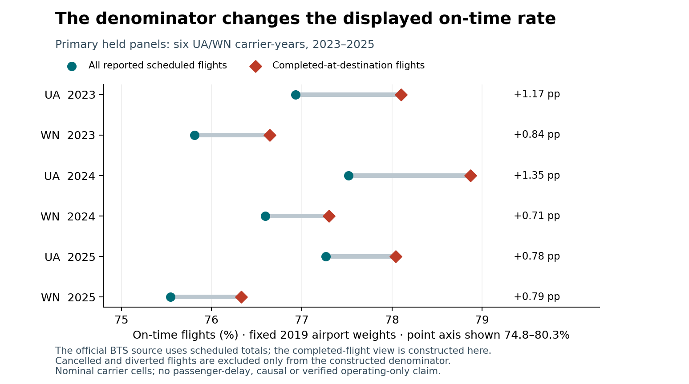

# Cancellation-aware airport reliability

A constructed completed-flight view raises the fixed-airport-weight on-time percentage by 0.708–1.353 percentage points across the six prespecified UA/WN carrier-year panels in 2023–2025. These are the same captured count cells with different denominators. The official BTS tabular on-time percentage already uses scheduled totals; this is not evidence that BTS omits cancellations.

Display scheduled-flight on-time, cancelled and diverted shares together, with the exact denominator and airport coverage. A completed-flight view can be a supplementary diagnostic. Verify reporting scope and original dated inputs before using these comparisons for a service decision; passenger-delay or rebooking decisions require passenger data.

This is a retrospective descriptive calculation on nominal published carrier codes, not independently verified operating-only or disjoint populations. Fixed airport weights do not control routes, weather, season or passengers. No causal airline strategy, actual cancellation action, passenger benefit, novelty or future performance is established.

Start with the [decision summary and full tables](DECISION_SUMMARY.md), [fixed protocol](PROTOCOL.md), [source/null interpretation](SOURCE_CLARIFICATION.md), [frozen dependencies](FREEZE.json), [all results](results) and [reviewed independent manuscript](paper/manuscript.pdf).



```text
python -m pip install -r requirements.txt
python -m unittest discover -s tests -v
python src/check_reproduction.py
python src/verify_figures.py
python src/verify_paper.py
python src/verify_public_package.py
```

Fifteen fixtures; 25 dependencies frozen before held summaries; independent SQL/rational math and exact isolated replay; all fixed scenarios and exclusions retained. Not peer reviewed. Formal-publication projects, including Azure, remain private.
